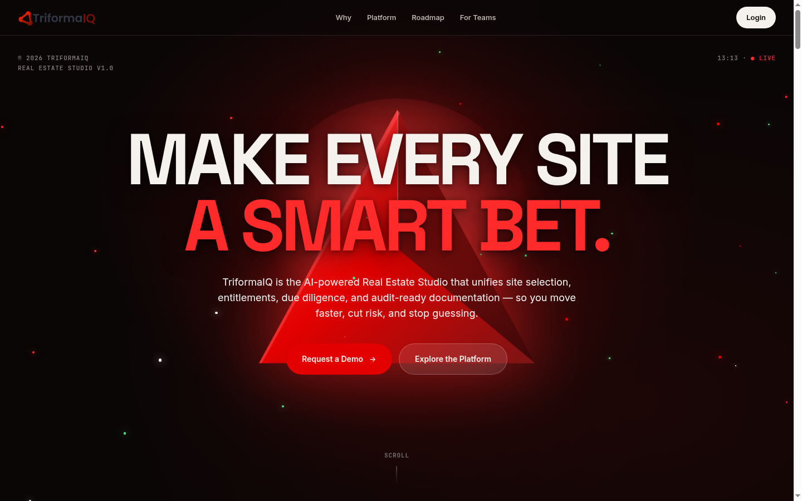

# TriformaIQ Real Estate Studio - BairesDev

Website: [https://www.triformaiq.com/](https://www.triformaiq.com/)

Developer: Manuel Solalinde [(manolosolalinde@gmail.com)](mailto:manolosolalinde@gmail.com)

TriformaIQ Real Estate Studio is an **AI-powered, multi-tenant SaaS platform** for commercial real estate teams. It brings site selection, entitlements, due diligence and audit-ready documentation into one workspace, so that teams can evaluate locations with data instead of guesswork.

## Overview

The platform combines interactive GIS with weighted multi-criteria scoring to compare candidate sites side by side. It also offers secure per-project document storage and an immutable audit trail. I work across the stack, mainly on the API and data layer, building AI features, SaaS infrastructure and geospatial capabilities for a product heading to launch.

## Contributions

- **LLM-powered document analysis (RAG)**: document ingestion and chunking, vector embeddings and semantic search on PostgreSQL/pgvector, structured LLM outputs grounded in verifiable source citations, and a regression evaluation harness to track prompt quality over time.
- **SaaS billing and licensing**: payment provider integration through webhooks, subscription lifecycle management, and plan-based feature gating enforced at the API layer.
- **Platform capabilities**: role-based approval workflows, per-user and per-organization rate limiting of third-party APIs, and geospatial data features, all with strict tenant data isolation.
- **AI-assisted engineering**: Claude Code workflows (custom skills and multi-agent orchestration) that automate ticket analysis, implementation, code review and end-to-end verification across the backend and frontend repositories.

## Architecture

- **Backend**: a FastAPI service organized as domain modules (API, application services, domain, repositories), with SQLModel/Alembic on PostgreSQL + PostGIS and Celery/Redis for background work.
- **Frontend**: a React + TypeScript dashboard that consumes an auto-generated OpenAPI client, with ArcGIS-based mapping.
- **Multi-tenancy**: every query is scoped to the authenticated tenant, which is derived from the JWT and never taken from client input.
- **Quality**: unit, integration and API tests with Pytest, Playwright end-to-end tests, and containerized development with Docker Compose.
